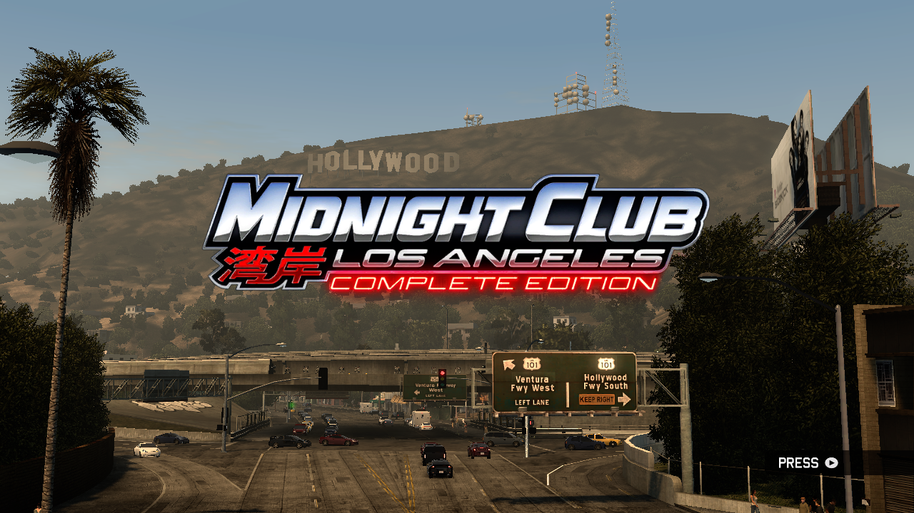
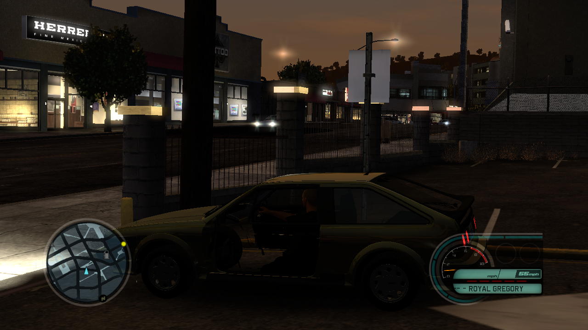

# MCLA PC

Native D3D12 port of Midnight Club: Los Angeles for Xbox 360 (Xenon) to PC. Guest PowerPC is statically recompiled ahead of time to native C++ with XenonRecomp — no interpreter, no JIT. The host implements the Xbox 360 kernel, XAM, audio, input and GPU intent natively.

Playable: about 90% of the way there, stable at 2K on an RTX 3070 Ti laptop. No retail content is bundled; you supply your own legally dumped `game_data`.



## Screenshots

Gameplay, night city drive:



## Requirements

* Windows 10 or 11, 64-bit.
* Visual Studio 2022 Build Tools, MSVC `14.44.35207`, Windows SDK `10.0.26100.0` (`CMakeLists.txt:229`, `:233-234`).
* LLVM at `C:/Program Files/LLVM` for `llvm-rc`.
* CMake 3.25+, Ninja, Python 3.14.
* An `.research/` checkout: `XenosRecomp`, `XenonRecomp`, `dxc-bin`. Not committed, and configure fails without it.
* `game_data` containing `default.xex` and `xarchive_cache.rpf`.

## Build

```bat
build_on_e.bat
build\mcla.exe
```

The name is historical, from when the tree lived on `E:`. The script is location independent; `build_on_e.bat build` skips configure. Exit `2` means vcvars failed, `3` configure failed, `4` the exe is stale or missing.

`generated/ppc_xenon` (176 translation units) is produced by the build. Do not hand edit it.

## Launcher

The launcher is a **standalone project**: [3bdull4h2008/mcla-launcher](https://github.com/3bdull4h2008/mcla-launcher). It is developed separately from this game repo. This repo also carries a separate in-tree WPF/WebView2 integration under `tools/launcher/`; use the standalone repo for launcher development.

The visual target is the game's own menus — the same typography, spacing, motion and HUD language, so it feels like part of Midnight Club rather than a generic AI-looking settings wrapper.

The in-tree settings front end is a WPF + WebView2 window (`LauncherHost.cs`) rendering `ui/index.html` from `ui/launcher.schema.json`. It writes `cache/mcla.toml`, then starts `build/mcla.exe` with the matching flags. It never modifies the game exe.

```bat
powershell -ExecutionPolicy Bypass -File tools\launcher\build_launcher.ps1
build\mcla_launcher.exe
```

Tabs: Play, Display & Video, Graphics & Shadows, Controls & Keymap, Tuning & Perf.

## Run

* `run_mcla.bat` is the canonical foreground/soak launcher. Fullscreen presets live in `tools/run-presets/`.
* Game data resolves to `game_data` next to the exe, else in the working directory; cache is `cache` next to the exe (`src/app.cpp:670-687`).
* Logging is off by default. `MCLA_LOG_LEVEL=2` restores the full census (`src/app.cpp:450-455`).
* DXIL needs `dxcompiler.dll` and `dxil.dll`; `MCLA_DXC_DIR` overrides the search (`src/renderer/dxc_runtime.cpp:497-532`).
* `mcla_fps` defaults to 60. `0` uncaps, `-1` restores the guest's stock 30 Hz timing (`src/hooks/frame_timing_ports.cpp:70-71`).
* Bounded, logged, single-instance run: `python tools/soak_run.py --tag test --secs 90`.

## What differs from other Xenon emulators

* One guest `default.xex` recompiled to C++ per translation unit. PowerPC never executes at runtime; the only runtime compiler is the Xenos shader path to DXIL.
* Graphics is D3D12 intent replay, not full Xenos GPU emulation. The command processor captures guest draw intent and the host issues it directly.
* Kernel objects, XAM UI, APU and XMA audio, and the RPF3 file system are host implementations, not guest code.

## Tech notes

* CP and IB packet flow. `src/gpu_cp.cpp` and `src/gpu_device.cpp` capture register writes and buffer pointers; the render thread turns captured draws into D3D12 draws.
* Shader translator. `src/renderer/shader_translator.cpp` decodes Xenos microcode to IR to HLSL to DXIL through DXC at runtime with a PSO cache.
* Renderer. `src/d3d12_backend.*` owns device, pipelines and presentation. `src/render_thread.*` owns draw submission. `src/fs/vfs_rpf.cpp` decodes the RPF3 archive.
* Guest facts come from the raw bytes of `build/cache/mcla_pe.bin` with offset `VA - 0x82000000`, confirmed against disassembly. Docs are intent only.

## Status

* Playable. Boot reaches the title, map, cutscenes and freeway driving with real assets.
* Star texture width is unproven; stars currently sample raw.
* City stall after ArrowBlit, spinner half-empty texture and the AES TOC slow start are carried over from an earlier snapshot and have not been re-verified.

## Legal

Retail content only. This repo contains no game assets, no game executables, and no ripped content. You must provide your own copy. Midnight Club and other names belong to their owners. This project is an unofficial fan recompilation effort. No endorsement is implied. The icon in this repo is original to this project. `LICENSE.txt` covers host code only.

## Thanks

* XenonRecomp for the PowerPC to C++ recompiler.
* Xenia for public reference on Xbox 360 behavior where cited in code.
* LARecomp and BadassBaboon for guest research facts such as addresses and quirks.
* The vendored libraries credited in `third_party` and `CMakeLists.txt`.
